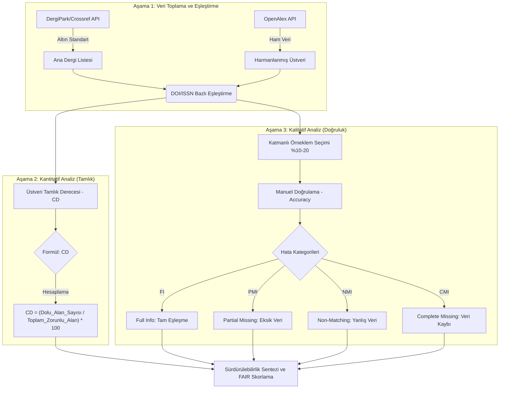

# Araştırma Metodolojisi ve Teorik Çerçeve Sentezi
## OpenAlex vs. DergiPark: Üstveri Kalitesi ve Sürdürülebilirlik Analizi

Bu doküman, "Sempozyum_26" Zotero koleksiyonunda yer alan güncel literatürün (2024-2026) senteziyle oluşturulmuş, çalışmanın metodolojik temelini ve araştırma sorularını içermektedir.

---

## 1. Araştırma Soruları (RQs)

Literatürdeki "yerel vs. küresel dizin" karşılaştırma şablonları (Alonso-Álvarez & van Eck, 2025; Céspedes et al., 2025) temel alınarak geliştirilmiştir:

*   **AS1 (Yapısal Tamlık):** OpenAlex, Türkiye merkezli Bilgi ve Belge Yönetimi (BBY) dergilerine ait yapısal üstverileri (Öz, Kurumsal Aidiyet, Dil, Fon Sağlayıcı) DergiPark "Altın Standart" verilerine kıyasla ne ölçüde kapsıyor?
*   **AS2 (Dilsel Doğruluk ve Görünürlük):** OpenAlex'in "otomatik veri harmanlama" (automatic harvesting) süreci, Türkçe yayınların dil etiketlemesinde ne kadarlık bir hata payı barındırıyor ve bu durum yerel literatürün küresel görünürlüğünü nasıl etkiliyor?
*   **AS3 (Kurumsal Tanımlama/Disambiguation):** Türkiye'deki kurumların OpenAlex üzerindeki ROR (Research Organization Registry) entegrasyonu ve kurumsal aidiyet verilerinin doğruluğu nedir?
*   **AS4 (FAIR ve Sürdürülebilirlik bağlantısı):** Üstveri kalitesindeki eksiklikler, yerel bilimsel iletişimin FAIR (Bulunabilirlik, Erişilebilirlik, Birlikte Çalışabilirlik, Yeniden Kullanılabilirlik) uyumluluğunu ve dijital sürdürülebilirliğini nasıl tehdit ediyor?

---

## 2. Metodolojik İş Akış Şeması

Bu akış, **Alonso-Álvarez & van Eck (2025)** tarafından önerilen "Üç Aşamalı Doğrulama" modelinin Türkiye bağlamına uyarlanmış halidir.

---

## 3. Üstveri Boyutları ve Teorik Dayanaklar

Literatürden süzülen kritik boyutlar ve ilgili atıflar:

| Boyut | Kaynak Atıf | Teorik Bağlantı |
| :--- | :--- | :--- |
| **Tamlık (Completeness)** | Delgado-Quirós & Ortega (2024) | "Üçüncü taraf veri kaynaklarının (OpenAlex vb.) temel sorunu, farklı kaynakları entegre ederken oluşan veri kaybıdır." |
| **Dilsel Kapsam (Linguistic Coverage)** | Céspedes et al. (2025) | "Otomatik harmanlama süreçlerinde İngilizce dışı dillerin sistematik olarak yanlış etiketlenmesi veya kapsanmaması." |
| **Doğruluk (Accuracy)** | Alonso-Álvarez & van Eck (2025) | "Yerel dizinlerin (DergiPark gibi) küresel dizinler için temel doğrulama kaynağı (Ground Truth) olarak kullanılması gerekliliği." |
| **Yayın Türü Kalitesi** | Doğan & Sezen (2026) | "Hakem değerlendirme raporlarının ve diğer paratext nesnelerinin üstveri karmaşası yaratması." |

---

## 4. Veri Kaybı ve "Otomatik Harmanlama" Riskleri

Delgado-Quirós & Ortega (2024)'e göre, OpenAlex gibi sistemlerin en büyük riski **"Provenance" (Köken)** hatalarıdır. Crossref üzerinden gelen verilerin yayıncı tarafından eksik girilmesi ("Null" değerler), OpenAlex'in bu veriyi otomatik olarak iyileştirememesine neden olur. 

**Analiz için Kritik Metrik:**
*   **Harvesting Efficiency (HE):** DergiPark'ta olup OpenAlex'e hiç aktarılamayan kayıtların oranı.
*   **Disambiguation Error Rate (DER):** Kurum isimlerinin (örneğin "Hacettepe University") yanlış ROR ID ile eşleşme sıklığı.

---
